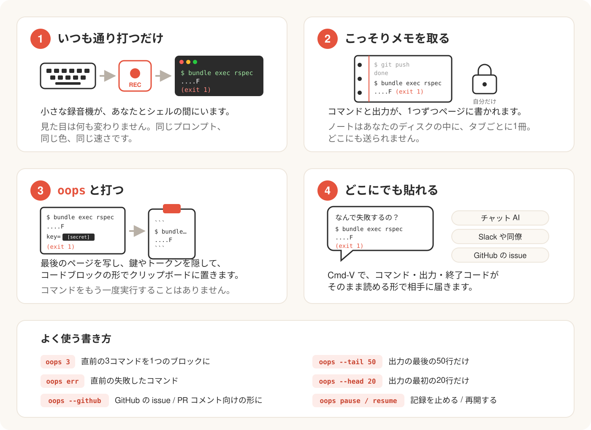

# oops

[English](README.md) | 日本語

[](https://rubygems.org/gems/oops-cli) [](https://github.com/ysb3996-blip/oops/actions/workflows/ci.yml) [](LICENSE)

直前のシェルコマンドとその出力を、貼り付けられる形でクリップボードにコピーします。

![デモ: テストが失敗し、oops がコマンドと出力をコピーし、コメント行と pbpaste でクリップボードの中身(コードブロック)を見せる。続いて cat .env、oops で API キーが [secret] になる](docs/demo.gif)

コマンドを実行して失敗した。その結果をチャットのアシスタントや Slack の同僚、GitHub の issue に見せたい。普通は、出力をドラッグで選択してコピーし、貼り付けて、コードフェンスを自分で付ける、という手間がかかります。oops なら 2 ステップです。

1. `oops`（直前の失敗したコマンドなら `oops err`）と打つ。
2. Cmd-V で貼り付ける。

クリップボードに入るのは、コマンド・出力・終了コードをまとめたコードブロックです。色は取り除かれ、トークン・鍵・メールアドレスはマスクされます。

## インストール

```sh
gem install oops-cli
```

Homebrew tap: 準備中です。

macOS または Linux（WSL は Linux 扱い）、Ruby 3.3 以降、zsh または bash が必要です。実行時に依存する gem はありません。

## シェルの設定

rc ファイルに 1 行足します（zsh は `~/.zshrc`、bash は `~/.bashrc`。macOS で bash の設定を `~/.bash_profile` に置いているなら、そちらに書きます）。

```sh
eval "$(oops init zsh)"    # zsh
eval "$(oops init bash)"   # bash
```

そのあと新しいタブを開いてください。開いているタブでは `exec zsh`（bash なら `exec bash`）で反映されます。

この行を置く場所が重要です。

- oops の入った Ruby を `PATH` に通す設定（rbenv、asdf、mise、Homebrew の `shellenv` など）より**後ろ**に置きます。macOS ではログインシェルが `PATH` をリセットするため、この行が先にあるとシステムの Ruby 2.6 が選ばれて oops が起動しないことがあります。oops が動かなくてもシェル自体は普通に起動します。記録されないだけです。
- 2 回実行したくない重い処理や出力の多い処理（nvm、プロンプトテーマ、バナーなど）より**前**に置きます。このスニペットは、小さな記録用プログラム（`oops record`、pty 中継）の下でシェルをもう一度起動します。そのため、この行より上は外側のシェルと内側のシェルで 2 回実行され、下は内側のシェルでだけ実行されます。
- powerlevel10k を使う場合は、`~/.zshrc` の先頭にある instant prompt のブロックより**上**に置きます。instant prompt は `~/.zshrc` の残りを読む間、シェルの入出力をリダイレクトし、その間スニペットは何もしません（実際の端末でだけ動作するため）。すると oops は黙って記録しなくなります。`~/.zshrc` に行があるのにタブが記録されないときは `oops doctor` を実行してください。`recording: no` と表示されます。
- zsh ではシェルがログインシェルではない形で再起動されます。`~/.zlogin` にだけ書いた設定は、記録されるシェルには適用されません。`~/.zprofile` か `~/.zshrc`（この行より上）に置いてください。bash ではログインシェルは `-l` 付きで再起動されます。

おかしいと感じたら `oops doctor` を実行します。このタブが記録されているか、シェルとフックの読み込み状況、使われるクリップボードの方法、設定ファイル、セッションログのサイズ、Ruby のバージョンを報告します。

1 つのシェルだけ oops を無効にするには、`OOPS_DISABLE=1`（例: `OOPS_DISABLE=1 zsh`）を付けて起動します。スニペットは何もしなくなります。

## 使い方

| コマンド | 内容 |
|---|---|
| `oops` | 直前のコマンドとその出力をコピーする |
| `oops 3` / `oops -n 3` | 直前の 3 コマンドを（古い順に）1 つのコードブロックとしてコピーする |
| `oops err` | 終了コードが 0 以外だった直近のコマンドをコピーする（成功したコマンドは飛ばす） |
| `oops err -n 2` | 直近の失敗した 2 コマンドを古い順にコピーする（成功したコマンドは飛ばす） |
| `oops init zsh` / `oops init bash` | シェルのスニペットを出力する（`eval` 用） |
| `oops doctor` | 記録・フック・クリップボード・設定・ログサイズを診断する |
| `oops pause` / `oops resume` | 記録を止める／再開する。停止中は何もディスクに書かれない |
| `oops status` | `recording`・`paused`・`off` のどれかを 1 行で出力する（スクリプトやプロンプト向け） |
| `oops record -- <shell>` | 内部用: 記録用プログラムの下でシェルを起動する。スニペットが呼び出す |
| `oops --version`, `oops --help` | バージョンと使い方 |

`oops`、`oops N`、`oops err` のオプション:

| オプション | 内容 |
|---|---|
| `-n N` | 直前の N コマンドをコピーする（`err` と併用すると直近の失敗した N コマンド） |
| `--github` | GitHub の issue / PR コメント向けの書式にする |
| `--tail N` | 出力の最後の N 行だけ残す |
| `--head N` | 出力の最初の N 行だけ残す（`--tail` と併用すると両端を残す） |
| `--time` | 各コマンドの開始時刻を `# 2026-10-31 19:30:09 +09:00` の行として付ける |
| `--output-only` | `$ コマンド` の行を省き、出力だけをコピーする |
| `--show-secrets` | 秘密情報をマスクせず、置換テーブルも適用しない |

`N` は正の整数で指定します。件数は位置引数の `N` または `-n N` のどちらかで 1 回だけ指定でき、併用や `-n` の繰り返しは使い方の誤りになります。対象のコマンドが指定件数より少なければ、見つかった分をコピーします。`-n` は上記の書式オプションと併用できます。

`oops` 自身はコピー対象になりません。直前のコマンドが `oops` だった場合は、その前のコマンドがコピーされます。

終了コード: `0` コピーした、`1` コピーしなかった（記録していない、まだコマンドがない、失敗したコマンドがない、一時停止中、クリップボードのコマンドが失敗）、`2` 使い方の誤り。

### 標準の出力

`oops` は `copied: $ bundle exec rspec (5 lines, 2 secrets masked)` のような 1 行を表示し、次の内容をクリップボードに入れます。

````
```
$ bundle exec rspec
....F

Failures:
  1) User#name returns full name
     expected "Taro Yamada", got "Taro"
(exit 1)
```
````

`(exit N)` は終了コードが 0 でないときだけ付きます。出力自体にコードフェンスが含まれているときは、バッククォート 4 つで囲みます。

### `--github`

出力が 30 行以内なら `console` ブロックになり、GitHub がシェルセッションとして色付けします。

````
```console
$ bundle exec rspec
....F
(exit 1)
```
````

それより長い出力は折りたたみ（`<details>`）で包まれ、要約にコマンド・終了コード・行数が出ます。

````
<details>
<summary><code>$ bundle exec rspec</code> — exit 1, 312 lines</summary>

```console
$ bundle exec rspec
...
(exit 1)
```

</details>
````

### `--tail` と `--head`

`oops --tail 50` は出力の最後の 50 行を残し、その前に `... 2,950 lines omitted ...` を入れます。`--head 20` は最初の 20 行を残し、その後ろに同じ印を入れます。両方指定すると、中間が印 1 行に置き換わります。`oops 3` では、行数の制限は各コマンドごとに適用されます。

### `--time` と `--output-only`

`oops --time` は、各 `$ コマンド` の前にコマンドを始めたローカル時刻を `#` の行として入れ、`--github` の要約にも時刻を足します。`oops --output-only` は `$ コマンド` の行を省いて出力と `(exit N)` だけを残します。画面に出る `copied: $ ...` の行と `--github` の要約には、コマンドの代わりに終了コードと行数だけが出ます。どちらも他のオプションと併用できます。

````
```
# 2026-10-31 19:30:09 +09:00
....F
(exit 1)
```
````

### `oops status`

`oops status` は `recording`・`paused`・`off`（このシェルが記録されていない、またはログが削除された）のどれかを出力し、記録中のときだけ終了コード `0` を返します。エラーは出さないので、プロンプトやスクリプトから呼べます（例: [starship のカスタムモジュール](https://starship.rs/config/#custom-commands)）。呼ぶたびに Ruby が起動するため 0.1〜0.2 秒ほどかかります。`off` のときの詳しい理由は `oops doctor` で分かります。

## 設定

任意の設定ファイルは `${XDG_CONFIG_HOME:-~/.config}/oops/config.yml` です。

```yaml
replace:            # コピー時に適用する単純な文字列置換
  takeuchi: dev
  MacBook-Pro: laptop
secrets:            # マスクする追加の正規表現
  - "sk_live_[A-Za-z0-9]+"
clipboard: auto     # auto | pbcopy | wl-copy | xclip | xsel | clip.exe | osc52 | 任意のコマンド（標準入力から読む）
```

- 置換とマスクはコピーする瞬間に適用されます。記録済みのログは変更されないため、設定を変えると以前のコマンドにも反映されます。
- `replace` のキーは長いものから順に、大文字小文字を区別して適用されます。
- 未知のキーは警告されて無視されます。YAML が壊れている場合も警告が出て、設定なしで続行します。
- `clipboard: auto` のとき、oops は macOS では `pbcopy`、WSL では `clip.exe`、Wayland では `wl-copy`、X11 では `xclip` か `xsel` を試し、だめなら OSC 52 端末エスケープシーケンスにフォールバックします（SSH 越しでもこれが使われます）。どれを選んだかは `oops doctor` で確認できます。
- 自分で指定した `clipboard:` のコマンドは、独自のプロセスグループで 5 秒のタイムアウト付きで実行されます。そのため端末の読み取りや設定（パスワード入力、`stty` など）はできません。コピー中の Ctrl-C もそのコマンドには届きません。

組み込みのマスク対象: AWS アクセスキー、GitHub / GitLab / Slack / npm / OpenAI・Anthropic（`sk-...`）/ Stripe / Google の API トークン、Slack の webhook URL、JWT、`Authorization` ヘッダーの値、秘密鍵ブロック（END 行がなくても）、`key`・`token`・`secret`・`password`・`passwd`・`pwd` を含む名前に代入された値、`--password <値>`・`curl -u user:pass`・`mysql -p<値>`・`docker login -p <値>` で渡されたパスワード、メールアドレス、URL 中の認証情報、公開 IPv4 アドレス（ループバックとプライベート範囲は対象外）。出力だけでなくコマンドラインにも適用されます。

マスクはパターンに基づくため、保証ではなく安全網です。知らない形式の秘密情報（たとえば 1 行に単独で出力された生のパスワード）は、そのままコピーされます。貼り付ける前に内容を確認し、必要なら設定ファイルの `secrets:` に自分のパターンを足してください。

## 仕組み



1. `oops init` は、rc ファイルから `eval` するスニペットを出力します。まだ記録されていない端末の対話シェルでは、シェルを `oops record` の下で再起動します。
2. `oops record` は、Ruby 製の小さな pty 中継です。キー入力とシェルの出力をそのまま通し、ウィンドウのリサイズをシェルに伝えます。
3. シェルのフック（zsh は `preexec`/`precmd`、bash は `DEBUG` トラップと `PROMPT_COMMAND`）が、各コマンドの前後に目に見えない APC マーカーを出力します。中継がそれを取り除くので、端末には見えません。
4. コマンドが終わるたびに、中継は 1 行の JSON（コマンド、ディレクトリ、時刻、終了コード、生の出力）をタブごとのログに追記します。置き場所は `${XDG_STATE_HOME:-~/.local/state}/oops/sessions/` です。出力は 1 コマンドあたり 1 MB まで（末尾を残す）。各タブのログは 50 MB までで、超えると新しいコマンドだけを残して書き直されます（約 37 MiB まで縮む）。タブが記録を始めるとき、閉じたタブのログは古い順に、全ログの合計が 50 MB 以下になるまで削除されます。開いているタブのログは削除されないので、忙しいタブが複数あると合計がそれを超えることがあります。
5. `oops` は現在のタブのログの末尾を読み、テキストを整えてマスクし、コードブロックを組み立ててクリップボードに渡します。コマンドを再実行することはありません。

## プライバシーとセキュリティ

- セッションログには、記録されたすべてのコマンドの生の出力が**マスクされないまま**入っています。マスクと置換テーブルはコピーするときにだけ適用されます。ログは `${XDG_STATE_HOME:-~/.local/state}/oops/sessions/` にあり、あなただけが読めます（ファイルは 0600、ディレクトリは 0700）。すべて削除するには `rm -rf "${XDG_STATE_HOME:-$HOME/.local/state}/oops"` を実行します（標準では `rm -rf ~/.local/state/oops`）。ディスクに残したくない秘密情報を表示する前には `oops pause` を使ってください。
- セキュリティ上の問題を非公開で報告する方法は [SECURITY.ja.md](SECURITY.ja.md) を見てください。公開の issue には書かないでください。
- 記録される出力は信頼できません。実行したプログラムは、oops のマーカーに見せかけたテキストを出力できます。そのため oops は、`oops pause` / `oops resume` が作るフラグファイルと一致する一時停止・再開マーカーにだけ従います。出力によって黙って記録を止められることはありません。ただし、プログラムがログ上でコマンドの開始と終了の位置を偽装することはできるので、貼り付ける内容は確認してください。

## 既知の制限

- 記録中のタブごとに Ruby プロセスが 1 つ常駐します（約 17 MB）。
- 環境変数を落とす `sudo -s` や `su` は、入れ子の 2 つ目の記録を始めるため、それらのコマンドは 2 回ログに残ります。
- 使えるのは現在のタブだけです。閉じたタブや以前のタブのものは取り出せません。
- OSC 52 経由（SSH やクリップボードツールがない場合）では、端末が一度に送れる量を制限します。oops は約 100 KB に切り詰めて警告します。OSC 52 は一方通行のエスケープシーケンスなので、端末がコピーを受け付けたかどうかは分かりません。無視する端末や確認を求める端末もあり、tmux では `set -g set-clipboard on` が必要です。
- 8192 文字を超えるコマンドは、記録されるコマンドラインが切り詰められます。
- vim・less・tmux などの全画面アプリの出力は保存されず、`[full-screen app output omitted]` に置き換わります。
- スペースで始まるコマンドラインは、zsh では記録されますが bash では記録されません（bash はそれを履歴に保存せず、oops はコマンドを履歴から読むため）。
- [bash-preexec](https://github.com/rcaloras/bash-preexec) を使う bash（atuin や Ghostty の bash 統合の背後にあるものも含む）: oops は自前の `DEBUG` トラップを使わず、bash-preexec にフックを登録します。rc ファイルでどちらが先でも同じです。bash が履歴に保存しなかった行（`HISTCONTROL=ignorespace`、`HISTIGNORE`）は、この場合 `(not saved in history)` と記録されます。行のテキストを履歴から読むためです。bash-preexec がない場合、oops はそのような行の最初のコマンドを記録します。
- Ghostty 上の bash: Ghostty のシェル統合（プロンプトマーク、同じディレクトリでの新しいタブ、タイトル）は外側のシェルにだけ入るため、記録される側のシェルには入りません。足し戻すには、`~/.bashrc` の oops の行の下に次の行を置きます（bash 3.2 で確認済み）: `[ -n "$GHOSTTY_RESOURCES_DIR" ] && source "$GHOSTTY_RESOURCES_DIR/shell-integration/bash/ghostty.bash"`。zsh は何もしなくて構いません。スニペットがやります。
- bash: パイプラインの次の行では、`PIPESTATUS` に最後の終了ステータスしか入りません（`false | true` の後に `echo ${PIPESTATUS[*]}` を実行すると、`1 0` ではなく `0` と表示されます）。oops の `PROMPT_COMMAND` の項目が先に実行されるためです。`$?` と `$_` は保たれます。パイプラインの各ステータスを表示するプロンプト（starship の `pipestatus`）は、bash では表示が少なくなります。zsh は `pipestatus` を保ちます。
- macOS: `pbcopy` は文字エンコーディングを `LANG` / `LC_*` から決めます。日本語などの非 ASCII 文字が文字化けして届くときは、UTF-8 のロケール（例: `LANG=en_US.UTF-8`）が設定されているか確認してください。SSH 越しで起動したシェルでは設定されていないことがあります。
- fish とネイティブ Windows にはまだ対応していません。

## 開発

### 手元の環境を整える

Git、Ruby 3.3 以降、[Bundler](https://bundler.io/)（Ruby に付属）、そして zsh と bash の両方が必要です（エンドツーエンドのテストが本物のシェルを起動するため）。macOS には zsh と bash が入っています。Debian / Ubuntu では `sudo apt-get install zsh` を実行します。

```sh
git clone https://github.com/ysb3996-blip/oops.git
cd oops
```

リポジトリは `.ruby-version` で Ruby 4.0.9 を指定しています。rbenv・asdf・mise などのバージョン管理ツールを使っている場合は、そのバージョンを入れてください（`rbenv install 4.0.9`、続けて `rbenv rehash`）。この指定を消すか無視すれば、3.3 以降の任意の Ruby でも動きます。`ruby -v` で確認します。

```sh
bin/setup                   # Ruby・zsh・bash を確認し、gem を入れて、チェックを実行する
```

`bin/setup` は、`bundle install` のあとに `bundle exec rake` を実行するのと同じです。`bundle exec rake` はテスト全体（約 30 秒）を実行したあと rubocop（スタイルのチェック）を実行します。`bundle exec rake test` と `bundle exec rubocop` で、1 つずつ実行することもできます。

CI は Ubuntu と macOS で、Ruby 3.3・3.4・4.0 を使ってこの 2 つを実行し、gem のビルドと、bash スニペットへの shellcheck（`shellcheck -S warning lib/oops/shell/oops.bash bin/setup`。手元に入れていれば実行できます）も行います。プルリクエストを出す前に、次を実行してください。

```sh
bundle exec rake && gem build oops-cli.gemspec
```

### 変更を試す

テストファイル 1 つだけなら `bundle exec ruby -Itest -Ilib test/ansi_test.rb` で実行できます。何もインストールせず、チェックアウトしたものからコマンドを直接動かすには:

```sh
bundle exec exe/oops --version
bundle exec exe/oops doctor
```

シェルから使うのと同じ形で試すには、使っている Ruby に gem をビルドしてインストールし、「シェルの設定」の 1 行を**新しい**タブで有効にします。

```sh
gem build oops-cli.gemspec
gem install ./oops-cli-0.1.0.gem     # ファイル名は lib/oops/version.rb に合わせる
rbenv rehash                         # rbenv を使う場合のみ
```

- gem は Ruby のバージョンごとに入ります。新しいタブが、インストールした Ruby とは別の Ruby を使っていると（たとえばリポジトリは 4.0.9 を指定しているのに、標準の Ruby が 3.3.5 の場合）、シェルに `oops: command not found` と出ます。その Ruby でも `gem install` を実行してください（例: `RBENV_VERSION=3.3.5 gem install ./oops-cli-0.1.0.gem`）。
- 変更のたびに入れ直してください。インストールされた gem はコピーで、チェックアウトへのリンクではありません。
- 削除するには `gem uninstall oops-cli` です。
- `eval "$(oops init zsh)"` は、プロンプトで打つだけでなく rc ファイルに書いてください。記録されるシェルは rc ファイルを読み直すため、行がないとフックが入りません（`oops doctor` に `hooks: missing` と出ます）。

作業中の端末で `oops record` を実行しないでください。テストは自前の pty を通して動かします。試すときは、新しい端末タブを使います。試した結果として残るログを消すには、「プライバシーとセキュリティ」を参照してください。

テストは、書式、秘密情報のマスク、ログの読み取り、ストリームパーサー、そして実際の zsh と bash を使った中継のエンドツーエンド実行を対象にしています。

リリース前の手動チェックリスト:

- Ghostty、Terminal.app、VS Code の統合ターミナルで、マーカーのゴミが表示されない。
- vim、less、全画面の端末アプリが、ウィンドウをリサイズしても追従する。
- 記録中のタブで `exec zsh` しても、2 つ目の記録が始まらない。
- 記録中のタブから `code .` で開いた VS Code のターミナルが、独立して記録される。

## コントリビュート

バグ報告、アイデア、プルリクエストを歓迎します。[CONTRIBUTING.ja.md](CONTRIBUTING.ja.md) を読んでください。`good first issue` のラベルが付いた issue が、始めやすい入口です。

## ライセンス

MIT。[LICENSE](LICENSE) を参照してください。
