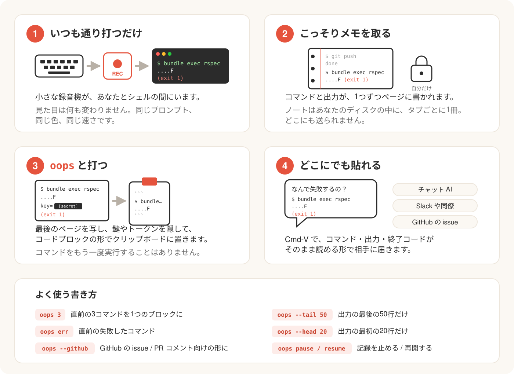

# oops

[English](README.md) | 日本語

[](https://rubygems.org/gems/oops-cli) [](https://github.com/ysb3996-blip/oops/actions/workflows/ci.yml) [](LICENSE) [](https://codecov.io/gh/ysb3996-blip/oops) [](#貢献してくれた人たち)

直前のシェルコマンドとその出力を、貼り付けられる形でクリップボードにコピーします。Claude Code に「なんで失敗したの？」と聞けば、同じ記録を Claude が自分で読みます。

![デモ: テストが失敗し、oops がコマンドと出力をコピーし、コメント行と pbpaste でクリップボードの中身(コードブロック)を見せる。続いて cat .env、oops で API キーが [secret] になる](docs/demo.gif)

> **Claude Code を使っているなら:** `/plugin install oops --marketplace ysb3996-blip/oops` でプラグインを入れて、「なんで失敗したの？」と聞くだけです。失敗したコマンドと出力を、秘密をマスクした状態で Claude が自分で読むので、貼り付けも、Claude にコマンドを実行し直させることも要りません。[AI コーディングエージェントと使う](#ai-コーディングエージェントと使う)を参照してください。

コマンドを実行して失敗した。その結果をチャットのアシスタントや Slack の同僚、GitHub の issue に見せたい。普通は、出力をドラッグで選択してコピーし、貼り付けて、コードフェンスを自分で付ける、という手間がかかります。oops なら 2 ステップです。

1. `oops`（直前の失敗したコマンドなら `oops err`）と打つ。
2. Cmd-V で貼り付ける。

クリップボードに入るのは、コマンド・出力・終了コードをまとめたコードブロックです。色は取り除かれ、トークン・鍵・メールアドレスはマスクされます。

## インストール

```sh
gem install oops-cli
```

Homebrew でも入れられます。

```sh
brew install ysb3996-blip/oops/oops
```

Homebrew 版は Homebrew の Ruby で oops を動かすので、`PATH` の先に古い Ruby があっても動きます。

macOS または Linux（WSL は Linux 扱い）、Ruby 3.3 以降、zsh・bash・fish のどれかが必要です。実行時に依存する gem はありません。

macOS の Terminal.app・iTerm2・Ghostty・VS Code の統合ターミナルで、手で動作を確かめています。ほかの端末でおかしな動きがあれば、issue で教えてください。

`gem install` は、そのとき有効な Ruby にだけ oops を入れます。gem は Ruby のバージョンごとに別々です。rbenv・asdf・mise などで別の Ruby を使うタブでは、`oops` が `command not found` のエラーになります（シェルの起動時にも出ます）。いつでも使える直し方は、有効な Ruby で `gem install oops-cli` をもう一度実行することです（rbenv なら続けて `rbenv rehash`）。`.ruby-version`・`.tool-versions`・`mise.toml` で Ruby を指定しているディレクトリの外では、代わりにインストールした Ruby を標準（グローバル）の Ruby に設定することもできます（例: `rbenv global 3.3.5`）。

### zsh のプラグインマネージャーで入れる

zsh なら、プラグインとして読み込むこともできます。clone したリポジトリの oops をそのまま動かすので、gem のインストールはいりません（Ruby 3.3 以上は必要です）。下の「シェルの設定」の 1 行の代わりになります。

```sh
# antidote: ~/.zsh_plugins.txt に追加
ysb3996-blip/oops

# zinit: ~/.zshrc に。`wait`（turbo モード）は付けない
zinit light ysb3996-blip/oops

# Oh My Zsh: clone してから ~/.zshrc の plugins=(...) に oops を追加
git clone https://github.com/ysb3996-blip/oops "${ZSH_CUSTOM:-$HOME/.oh-my-zsh/custom}/plugins/oops"

# プラグインマネージャーなし: clone してから ~/.zshrc に source の行を追加
git clone https://github.com/ysb3996-blip/oops ~/.oops
source ~/.oops/oops.plugin.zsh
```

- 読み込みを後回しにしないでください（zinit の `wait`、zsh-defer など）。プラグインはシェルを記録用に起動し直すので、最初のプロンプトより前に済ませる必要があります。
- 下の「シェルの設定」にある、行を置く場所の注意は、プラグインを読み込む場所にそのまま当てはまります。powerlevel10k の instant prompt を使っている場合、プラグインは instant prompt のブロックより上で読み込む必要がありますが、プラグインマネージャーはふつうそうなりません。その場合は rc ファイルの 1 行を使ってください。
- `PATH` の Ruby が古いと、`oops: ... init zsh failed (oops needs Ruby 3.3 or later); recording disabled` と出て、記録なしで普通に起動します。
- プラグインマネージャーは `main` ブランチから更新するので、最新のリリースより先の内容になることがあります。

### Claude Code で使う場合

Claude Code を使っているなら、Claude Code の中で oops プラグインも入れてください。タブで最後に失敗したコマンドを、貼り付けなしで Claude が読めるようになります（[Claude Code のプラグイン](#claude-code-のプラグイン)を参照）。

```
/plugin install oops --marketplace ysb3996-blip/oops
```

## シェルの設定

rc ファイルに 1 行足します（zsh は `~/.zshrc`、bash は `~/.bashrc`。macOS で bash の設定を `~/.bash_profile` に置いているなら、そちらに書きます）。

```sh
eval "$(oops init zsh)"    # zsh
eval "$(oops init bash)"   # bash
```

fish では、`~/.config/fish/config.fish` に次の 1 行を足します。

```fish
oops init fish | source
```

そのあと新しいタブを開いてください。開いているタブでは `exec zsh`（bash なら `exec bash`、fish なら `exec fish`）で反映されます。

この行を置く場所が重要です。

- oops の入った Ruby を `PATH` に通す設定（rbenv、asdf、mise、Homebrew の `shellenv` など）より**後ろ**に置きます。macOS ではログインシェルが `PATH` をリセットするため、この行が先にあるとシステムの Ruby 2.6 が選ばれて oops が起動しないことがあります。oops が動かなくてもシェル自体は普通に起動します。記録されないだけです。
- 2 回実行したくない重い処理や出力の多い処理（nvm、プロンプトテーマ、バナーなど）より**前**に置きます。このスニペットは、小さな記録用プログラム（`oops record`、pty 中継）の下でシェルをもう一度起動します。そのため、この行より上は外側のシェルと内側のシェルで 2 回実行され、下は内側のシェルでだけ実行されます。
- powerlevel10k を使う場合は、`~/.zshrc` の先頭にある instant prompt のブロックより**上**に置きます。instant prompt は `~/.zshrc` の残りを読む間、シェルの入出力をリダイレクトし、その間スニペットは何もしません（実際の端末でだけ動作するため）。すると oops は黙って記録しなくなります。`~/.zshrc` に行があるのにタブが記録されないときは `oops doctor` を実行してください。`recording: no` と表示されます。
- zsh ではシェルがログインシェルではない形で再起動されます。`~/.zlogin` にだけ書いた設定は、記録されるシェルには適用されません。`~/.zprofile` か `~/.zshrc`（この行より上）に置いてください。bash ではログインシェルは `-l` 付きで、fish では `--login` 付きで再起動されます。
- fish は最初のプロンプトを出す直前に再起動されます。そのため、行をどこに置いても、`config.fish` 全体が外側と記録される側の両方で実行されます（もっと早く再起動すると、プロンプトを出さない `fish -i -c` や `fish -i script.fish` まで再起動してしまうためです）。

おかしいと感じたら `oops doctor` を実行します。このタブが記録されているか、シェルとフックの読み込み状況、使われるクリップボードの方法、設定ファイル、セッションログのサイズ、Ruby のバージョンを報告します。

1 つのシェルだけ oops を無効にするには、`OOPS_DISABLE=1`（例: `OOPS_DISABLE=1 zsh`）を付けて起動します。スニペットは何もしなくなります。

## 使い方

| コマンド | 内容 |
|---|---|
| `oops` | 直前のコマンドとその出力をコピーする |
| `oops 3` / `oops -n 3` | 直前の 3 コマンドを（古い順に）1 つのコードブロックとしてコピーする |
| `oops err` | 終了コードが 0 以外だった直近のコマンドをコピーする（成功したコマンドは飛ばす） |
| `oops err -n 2` | 直近の失敗した 2 コマンドを古い順にコピーする（成功したコマンドは飛ばす） |
| `oops init zsh` / `oops init bash` / `oops init fish` | シェルのスニペットを出力する（`eval` 用。fish は `\| source`） |
| `oops doctor` | 記録・フック・クリップボード・設定・ログサイズを診断する |
| `oops pause` / `oops resume` | 記録を止める／再開する。停止中は何もディスクに書かれない |
| `oops status` | `recording`・`paused`・`off` のどれかを 1 行で出力する（スクリプトやプロンプト向け） |
| `oops clear` / `oops clear --all` | 閉じたタブのログを削除する。`--all` を付けると、今のタブのログも空にする |
| `oops record -- <shell>` | 内部用: 記録用プログラムの下でシェルを起動する。スニペットが呼び出す |
| `oops --version`, `oops --help` | バージョンと使い方 |

`oops`、`oops N`、`oops err` のオプション:

| オプション | 内容 |
|---|---|
| `-n N` | 直前の N コマンドをコピーする（`err` と併用すると直近の失敗した N コマンド） |
| `--github` | GitHub の issue / PR コメント向けの書式にする |
| `--time` | 各コマンドの開始時刻を `# 2026-10-31 19:30:09 +09:00` の行として付ける |
| `--output-only` | `$ コマンド` の行を省き、出力だけをコピーする |
| `-p`, `--print` | クリップボードの代わりに標準出力へ書き出す（`copied:` 行は出さない） |
| `--json` | コマンドを JSON で標準出力へ書き出す（スクリプトやエージェント向け） |
| `--gist` | [GitHub CLI](https://cli.github.com) で secret gist に上げ、その URL をコピーする（[下記](#--gist)） |
| `--show-secrets` | 秘密情報をマスクせず、置換テーブルも適用しない |

`N` は正の整数で指定します。件数は位置引数の `N` または `-n N` のどちらかで 1 回だけ指定でき、併用や `-n` の繰り返しは使い方の誤りになります。対象のコマンドが指定件数より少なければ、見つかった分をコピーします。`-n` は上記の書式オプションと併用できます。

`oops` 自身はコピー対象になりません。直前のコマンドが `oops` だった場合は、その前のコマンドがコピーされます。

終了コード: `0` コピーした（または `--print`・`--json` で出力した、`--gist` で上げた）、`1` コピーしなかった（記録していない、まだコマンドがない、失敗したコマンドがない、一時停止中、クリップボードのコマンドが失敗、`--gist` で `gh` が失敗）、`2` 使い方の誤り。

### 標準の出力

`oops` は `copied: $ bundle exec rspec (5 lines, 2 secrets masked)` のような 1 行を表示し、次の内容をクリップボードに入れます。

````
```
$ bundle exec rspec
....F

Failures:
  1) User#name returns full name
     expected "Taro Yamada", got "Taro"
(exit 1)
```
````

`(exit N)` は終了コードが 0 でないときだけ付きます。出力自体にコードフェンスが含まれているときは、バッククォート 4 つで囲みます。

### `--github`

出力が 30 行以内なら `console` ブロックになり、GitHub がシェルセッションとして色付けします。

````
```console
$ bundle exec rspec
....F
(exit 1)
```
````

それより長い出力は折りたたみ（`<details>`）で包まれ、要約にコマンド・終了コード・行数が出ます。

````
<details>
<summary><code>$ bundle exec rspec</code> — exit 1, 312 lines</summary>

```console
$ bundle exec rspec
...
(exit 1)
```

</details>
````

### `--time` と `--output-only`

`oops --time` は、各 `$ コマンド` の前にコマンドを始めたローカル時刻を `#` の行として入れ、`--github` の要約にも時刻を足します。`oops --output-only` は `$ コマンド` の行を省いて出力と `(exit N)` だけを残します。画面に出る `copied: $ ...` の行と `--github` の要約には、コマンドの代わりに終了コードと行数だけが出ます。どちらも他のオプションと併用できます。

````
```
# 2026-10-31 19:30:09 +09:00
....F
(exit 1)
```
````

### `--json`

`oops --json` は、選んだコマンドを Markdown のブロックとしてコピーする代わりに、古い順の JSON 配列として標準出力へ書き出します。`N`・`err`・`-n`・`--show-secrets` と併用できます。`--github`・`--time`・`--output-only` は Markdown の形を変えるオプションなので、併用すると使い方の誤りになります。コマンド・ディレクトリ・出力は、クリップボードと同じように整えてマスクします。`output` の末尾に改行は付かず、`exit` は終了コード（成功なら `0`）、時刻はローカル時刻の ISO 8601 です（分からないときは `null`）。

```json
[
  {
    "command": "ls /nothing-here",
    "cwd": "~/app",
    "exit": 1,
    "started_at": "2026-11-07T10:19:05+09:00",
    "ended_at": "2026-11-07T10:19:05+09:00",
    "output": "ls: /nothing-here: No such file or directory"
  }
]
```

### `--gist`

長い出力は、チャットや issue に貼りにくいものです。`oops --gist` は、整えた文字列を secret gist に上げ、文字列の代わりに gist の URL をコピーして表示します。

```console
$ oops err --gist
gist: https://gist.github.com/you/4f1e8c0b2d9a7e6f5c3b1a0d9e8f7c6b (1 lines)
```

oops 自身は GitHub とやり取りしません。[GitHub CLI](https://cli.github.com) の `gh gist create` を呼ぶので、`gh` を入れて、一度 `gh auth login` でログインしておく必要があります。gist の中身は `oops.md` という1ファイルで、説明欄には1つ目のコマンドの行が入ります。`N`・`err`・`-n`・`--github`・`--time`・`--output-only` と併用できます。

secret gist は一覧にも検索にも出ませんが、URL を知っていれば誰でも開けます。そのため秘密情報は必ずマスクします。`--show-secrets` を `--gist` と併用すると使い方の誤りになり、`--print`・`--json` との併用も同じです。要らなくなった gist は、gist.github.com か `gh gist delete` で消してください。クリップボードのツールが見つからないときも URL は表示し、コピーできなかったことを警告します。

### `oops status`

`oops status` は `recording`・`paused`・`off`（このシェルが記録されていない、またはログが削除された）のどれかを出力し、記録中のときだけ終了コード `0` を返します。エラーは出さないので、プロンプトやスクリプトから呼べます（例: [starship のカスタムモジュール](https://starship.rs/config/#custom-commands)）。呼ぶたびに Ruby が起動するため 0.1〜0.2 秒ほどかかります。`off` のときの詳しい理由は `oops doctor` で分かります。

## AI コーディングエージェントと使う


Claude Code のようにターミナルで動くコーディングエージェントは、起動したタブの環境変数を引き継いでシェルコマンドを実行します。そのため記録中のタブで起動すると、エージェント自身が `oops -p` を実行して、起動する前にそのタブで実行したコマンドと出力を、クリップボードと同じようにマスクした状態で読めます。貼り付けは要らず、エージェントがコマンドを実行し直す必要もありません。

```console
$ bundle exec rake test      # 失敗する
$ claude
> `oops -p err` を実行して、失敗したテストを直して。
```

Claude Code では `! oops -p err` と打って、自分で出力を会話に入れることもできます。直近 3 つのコマンドなら `-n 3` を付けます。スクリプトやエージェントが終了コードと出力を別々に扱いたいときは [`--json`](#--json) を使えます。ほかのターミナルのエージェントも、シェルコマンドに環境変数を引き継ぐものなら同じように使えます（例: [Codex CLI](#codex-cli)）。

特に役立つのは、コマンドを実行し直したくないときです。

- 時間がかかる（テスト全体、Docker のビルド）、またはたまにしか失敗しない。
- 何かを変える（`terraform apply`、マイグレーション、デプロイ）。
- エージェントに渡していない権限が要る（本番の `kubectl`、MFA のセッション、`sudo`）。
- 出力にトークンや鍵が含まれる。エージェントが見る前にマスクされます（マスクはパターンによるもので、範囲は[設定](#設定)を参照）。

エージェントが読めるのは、起動したタブで、起動する前に終わったコマンドだけです。Claude Code で新しく何かを見せたいときは、いったん終了してコマンドを実行し、`claude --continue` で戻ります。

### Claude Code のプラグイン

Claude Code 用の oops プラグインを入れると `/oops:err` が使えます。そのタブで最後に失敗したコマンドを会話に入れ、後ろに頼みごとを続けられます（`/oops:err 直して`）。打つ機会はあまりありません。直前に失敗したコマンドについて聞くと（「さっきのなんで失敗したの？」）、Claude Code が自分から使います。Claude Code の中で次のように入れます。

```
/plugin install oops --marketplace ysb3996-blip/oops
```

Claude Code 2.1.275 より前では、`/plugin marketplace add ysb3996-blip/oops` の後に `/plugin install oops@oops` を実行します。プラグインを使うには `oops` コマンド自体が要ります（[インストール](#インストール)を参照）。

プラグインを使わない場合は、次の内容を `~/.claude/commands/oops.md` に保存して `/oops` と打ちます。こちらも同じように Claude Code が自分から使います。

```markdown
---
description: Read the last failed command in this terminal tab (recorded by oops)
allowed-tools: Bash(oops:*)
---
The last command that failed in this terminal tab, recorded by oops (secrets masked):

!`oops -p err`

$ARGUMENTS
```

まだ何も失敗していないときや、タブが記録されていないときは、代わりに oops のメッセージが表示されます。

### Codex CLI

記録中のタブで起動した [Codex CLI](https://github.com/openai/codex) も `oops -p err` を実行できます（例: `codex exec "Run oops -p err and fix the failing test"`）。Codex の `read-only` のサンドボックスでも動きます。名指ししなくても使ってほしいときは、次の内容を `~/.codex/AGENTS.md`（全プロジェクト共通）かプロジェクトの `AGENTS.md` に足します。

```markdown
## Failed commands in my terminal

This terminal tab is recorded by [oops](https://github.com/ysb3996-blip/oops). When I ask about a command I ran that failed, run `oops -p err` to read its command line, output and exit code (secrets are masked) instead of asking me to paste it or running it again. `oops -p -n 3` shows the last 3 commands.
```

これがあれば「さっきのコマンド、なんで失敗したの？」だけで足ります。無いと、Codex は「端末は見えない」と答えます。

## 設定

任意の設定ファイルは `${XDG_CONFIG_HOME:-~/.config}/oops/config.yml` です。

```yaml
replace:            # コピー時に適用する単純な文字列置換
  takeuchi: dev
  MacBook-Pro: laptop
secrets:            # マスクする追加の正規表現
  - "sk_live_[A-Za-z0-9]+"
clipboard: auto     # auto | pbcopy | wl-copy | xclip | xsel | clip.exe | osc52 | 任意のコマンド（標準入力から読む）
retention_days: 7   # この日数より古いコマンドを削除する。false なら残す
```

- 置換とマスクはコピーする瞬間に適用されます。記録済みのログは変更されないため、設定を変えると以前のコマンドにも反映されます。
- `replace` のキーは長いものから順に、大文字小文字を区別して適用されます。
- 未知のキーは警告されて無視されます。YAML が壊れている場合も警告が出て、設定なしで続行します。
- `clipboard: auto` のとき、oops は macOS では `pbcopy`、WSL では `clip.exe`、Wayland では `wl-copy`、X11 では `xclip` か `xsel` を試し、だめなら OSC 52 端末エスケープシーケンスにフォールバックします（SSH 越しでもこれが使われます）。どれを選んだかは `oops doctor` で確認できます。
- `retention_days`（標準は 7）は、閉じたタブがログに最後に書き込んだ時点から数えます。古いログは、タブが記録を始めるときに削除されます。開いたままのタブも、コマンドが終わったときに、自分のログからこの日数より古いコマンドを落とします（1 時間に 1 回まで）。何も実行していないタブでは、次のコマンドまで残ります。`false` にすると、ログは 50 MB の上限で削除されるまで残ります。
- 自分で指定した `clipboard:` のコマンドは、独自のプロセスグループで 5 秒のタイムアウト付きで実行されます。そのため端末の読み取りや設定（パスワード入力、`stty` など）はできません。コピー中の Ctrl-C もそのコマンドには届きません。

組み込みのマスク対象: AWS アクセスキー、GitHub / GitLab / Slack / npm / OpenAI・Anthropic（`sk-...`）/ Stripe / Google の API トークン、Slack の webhook URL、JWT、`Authorization` ヘッダーの値、秘密鍵ブロック（END 行がなくても）、`key`・`token`・`secret`・`password`・`passwd`・`pwd` を含む名前に代入された値、`--password <値>`・`curl -u user:pass`・`mysql -p<値>`・`docker login -p <値>` で渡されたパスワード、メールアドレス、URL 中の認証情報、公開 IPv4 アドレス（ループバックとプライベート範囲は対象外）。出力だけでなくコマンドラインにも適用されます。

マスクはパターンに基づくため、保証ではなく安全網です。知らない形式の秘密情報（たとえば 1 行に単独で出力された生のパスワード）は、そのままコピーされます。貼り付ける前に内容を確認し、必要なら設定ファイルの `secrets:` に自分のパターンを足してください。

## 仕組み



1. `oops init` は、rc ファイルから `eval` する（fish では `| source` する）スニペットを出力します。まだ記録されていない端末の対話シェルでは、シェルを `oops record` の下で再起動します。
2. `oops record` は、Ruby 製の小さな pty 中継です。キー入力とシェルの出力をそのまま通し、ウィンドウのリサイズをシェルに伝えます。
3. シェルのフック（zsh は `preexec`/`precmd`、bash は `DEBUG` トラップと `PROMPT_COMMAND`、fish は `fish_preexec`/`fish_postexec` イベント）が、各コマンドの前後に目に見えない APC マーカーを出力します。中継がそれを取り除くので、端末には見えません。
4. コマンドが終わるたびに、中継は 1 行の JSON（コマンド、ディレクトリ、時刻、終了コード、生の出力）をタブごとのログに追記します。置き場所は `${XDG_STATE_HOME:-~/.local/state}/oops/sessions/` です。出力は 1 コマンドあたり 1 MB まで（末尾を残す）。各タブのログは 50 MB までで、超えると新しいコマンドだけを残して書き直されます（約 37 MiB まで縮む）。タブが記録を始めるとき、閉じたタブのログのうち `retention_days`（標準は 7 日）を過ぎたものが削除され、続いて残りが古い順に、全ログの合計が 50 MB 以下になるまで削除されます。開いているタブのログは削除されないので、忙しいタブが複数あると合計がそれを超えることがあります。ログ名のプロセスが動いていて、しかもログに最後に書き込まれる前に起動していれば、そのタブは開いているとみなします。開いているタブも、コマンドが終わったときに、`retention_days` より古いコマンドを自分のログから落とします（1 時間に 1 回まで）。
5. `oops` は現在のタブのログの末尾を読み、テキストを整えてマスクし、コードブロックを組み立ててクリップボードに渡します。コマンドを再実行することはありません。

## プライバシーとセキュリティ

- セッションログには、記録されたすべてのコマンドの生の出力が**マスクされないまま**入っています。マスクと置換テーブルはコピーするときにだけ適用されます。ログは `${XDG_STATE_HOME:-~/.local/state}/oops/sessions/` にあり、あなただけが読めます（ファイルは 0600、ディレクトリは 0700）。`retention_days` が標準の 7 なら、閉じたタブのログは最後のコマンドから 7 日たつと（別のタブが記録を始めるときに）削除され、開いているタブはコマンドが終わったときに 7 日より古いコマンドを落とします。閉じたタブのログは `oops clear` ですぐに削除でき、`oops clear --all` なら今のタブのログも空にします。開いている他のタブのログも含めてすべて削除するには `rm -rf "${XDG_STATE_HOME:-$HOME/.local/state}/oops"` を実行します（標準では `rm -rf ~/.local/state/oops`）。ディスクに残したくない秘密情報を表示する前には `oops pause` を使ってください。
- セキュリティ上の問題を非公開で報告する方法は [SECURITY.ja.md](SECURITY.ja.md) を見てください。公開の issue には書かないでください。
- 記録される出力は信頼できません。実行したプログラムは、oops のマーカーに見せかけたテキストを出力できます。そのため oops は、`oops pause` / `oops resume` が作るフラグファイルと一致する一時停止・再開マーカーにだけ従います。出力によって黙って記録を止められることはありません。ただし、プログラムがログ上でコマンドの開始と終了の位置を偽装することはできるので、貼り付ける内容は確認してください。

## 既知の制限

- 記録中のタブごとに Ruby プロセスが 1 つ常駐します（約 17 MB）。
- 環境変数を落とす `sudo -s` や `su` は、入れ子の 2 つ目の記録を始めるため、それらのコマンドは 2 回ログに残ります。
- 使えるのは現在のタブだけです。閉じたタブや以前のタブのものは取り出せません。
- OSC 52 経由（SSH やクリップボードツールがない場合）では、端末が一度に送れる量を制限します。oops は約 100 KB に切り詰めて警告します。OSC 52 は一方通行のエスケープシーケンスなので、端末がコピーを受け付けたかどうかは分かりません。無視する端末や確認を求める端末もあり、tmux では `set -g set-clipboard on` が必要です。
- 8192 文字を超えるコマンドは、記録されるコマンドラインが切り詰められます。
- vim・less・tmux などの全画面アプリの出力は保存されず、1 行に置き換わります。コマンドラインが 1 つのコマンドだけで、その名前が英数字と `. _ + - /` だけなら、その行にコマンド名が入ります（ページャーを通した `git log` なら `[git: full-screen output omitted]`）。そうでなければ `[full-screen app output omitted]` です。全画面になる前と後に出た行は残ります。
- スペースで始まるコマンドラインは、zsh では記録されますが bash では記録されません（bash はそれを履歴に保存せず、oops はコマンドを履歴から読むため）。
- [bash-preexec](https://github.com/rcaloras/bash-preexec) を使う bash（atuin や Ghostty の bash 統合の背後にあるものも含む）: oops は自前の `DEBUG` トラップを使わず、bash-preexec にフックを登録します。rc ファイルでどちらが先でも同じです。bash が履歴に保存しなかった行（`HISTCONTROL=ignorespace`、`HISTIGNORE`）は、この場合 `(not saved in history)` と記録されます。行のテキストを履歴から読むためです。bash-preexec がない場合、oops はそのような行の最初のコマンドを記録します。
- Ghostty のシェル統合（プロンプトマーク、同じディレクトリでの新しいタブ、タイトル）は、外側のシェルにだけ入ります。入っていた場合は、zsh・fish・bash のどれでも、スニペットが記録される側のシェルにもう一度読み込みます。bash 3.2（macOS の `/bin/bash`）には Ghostty が統合を入れられないので、読み込まれません。使いたい場合は、`~/.bashrc` の oops の行の下に次の行を置きます: `[ -n "$GHOSTTY_RESOURCES_DIR" ] && source "$GHOSTTY_RESOURCES_DIR/shell-integration/bash/ghostty.bash"`。
- bash: パイプラインの次の行では、`PIPESTATUS` に最後の終了ステータスしか入りません（`false | true` の後に `echo ${PIPESTATUS[*]}` を実行すると、`1 0` ではなく `0` と表示されます）。oops の `PROMPT_COMMAND` の項目が先に実行されるためです。`$?` と `$_` は保たれます。パイプラインの各ステータスを表示するプロンプト（starship の `pipestatus`）は、bash では表示が少なくなります。zsh は `pipestatus` を保ちます。
- macOS: `pbcopy` は文字エンコーディングを `LANG` / `LC_*` から決めます。日本語などの非 ASCII 文字が文字化けして届くときは、UTF-8 のロケール（例: `LANG=en_US.UTF-8`）が設定されているか確認してください。SSH 越しで起動したシェルでは設定されていないことがあります。
- ネイティブ Windows にはまだ対応していません。

## トラブルシューティング

`oops doctor` は確認ごとに `label: value` の行を 1 つ出力します。おかしい行があれば、下から探してください。例のパスは仮のものです。

- `recording: no`: このタブは記録されていません（シェルの行も `hooks: missing` になりますが、この場合はそれで正常です）。rc ファイルに `oops init` の行があり、oops の入った Ruby を `PATH` に通す設定より後ろにあるか確認し（「シェルの設定」を参照）、新しいタブを開いてください。powerlevel10k では、instant prompt のブロックより上に置く必要があります。
- `recording: yes (/Users/you/.local/state/oops/sessions/... - log file missing)`: このタブのログがありません。後の行が `log writable: no (no status file)` なら、タブを開いたときにログを作れませんでした（そのときタブに `oops: warning: session log unavailable (...)` が出ています）。たいていは状態ディレクトリ（既定は `~/.local/state/oops`）が別のユーザーの持ち物になっている（`sudo` で oops を動かした後など）か、書き込めないのが原因です。自分の持ち物に戻して書き込めるようにしてから、新しいタブを開いてください。直すまでは、新しいタブでも同じ表示になります。そうでなければ、タブを開いたままログが削除されました（`rm -rf ~/.local/state/oops` など）。新しいタブを開いてください。
- `this terminal: not the recorded tty (this: ..., recorded: ...)`: このシェルは、起動元の記録中のタブとは別の端末（tmux のペインや、記録中のタブから開いた端末ウィンドウ）で動いていて、自分では記録されていません。そのため、ここでの `oops` は起動元のタブのログを読みます。こうしたシェルは通常それ自身で記録されるので、そこでも `oops init` の行が実行されているか、`OOPS_DISABLE` が設定されていないかを確認してください。`this: unknown` のときは、`oops doctor` が端末から実行されていない（記録中のタブで AI コーディングエージェントが実行した場合など）ので、どの端末か判定できていません。プロンプトで自分で `oops doctor` を実行してください。
- `log writable: no (log-error: ...)`: ログへの書き込みに失敗しました。理由は `log-error:` の後に出ます（ディスクの空き不足など）。原因を直して、新しいタブを開いてください。
- `paused: yes`: `oops pause` で記録が一時停止しています。`oops resume` を実行してください。
- 最初の行が `recording: yes` なのに `shell: zsh, hooks: missing`: シェルは記録されていますが、フックが読み込まれていないので、コマンドはログに残りません。行を rc ファイルに書かず、プロンプトで入力した可能性があります。記録される側のシェルは rc ファイルを読み直すので、行が rc ファイルに必要です。足したら新しいタブを開いてください。
- `pbcopy`・`wl-copy`・`xclip`・`xsel` のつもりが `clipboard: osc52` になる: そのツールが `PATH` にありません（または `DISPLAY` / `WAYLAND_DISPLAY` が設定されていません）。インストールするか、設定ファイルで `clipboard:` を指定してください。SSH 越しなら `osc52` で正常です。
- `config: /Users/you/.config/oops/config.yml (unknown key: clipbord)`: キーの綴りの誤りです。そのキーは無視されます。`(could not parse /Users/you/.config/oops/config.yml: ...)` は YAML が壊れていて、oops が設定なしで動いていることを表します。`(missing)` は設定ファイルがないだけで、問題ありません。
- `warning: ~/.bashrc sets a DEBUG trap ...` または `warning: ~/.bashrc assigns PROMPT_COMMAND without appending ...`（bash のみ）: `oops init bash` の行より下の行が、oops のフックを置き換えることがあります。その行を oops の行より上に移してください。`PROMPT_COMMAND` の代入なら、今の値を残す形にしてもかまいません（`PROMPT_COMMAND="...;$PROMPT_COMMAND"`）。

どれにも当てはまらないときは、`oops doctor` の出力全体を付けて[バグ報告](https://github.com/ysb3996-blip/oops/issues/new?template=bug_report.md)を出してください（セッションログは貼らないでください）。

## 開発

### 手元の環境を整える

Git、Ruby 3.3 以降、[Bundler](https://bundler.io/)（Ruby に付属）、そして zsh と bash の両方が必要です（エンドツーエンドのテストが本物のシェルを起動するため）。macOS には zsh と bash が入っています。Debian / Ubuntu では `sudo apt-get install zsh` を実行します。fish はなくても構いません。入っていなければ fish のエンドツーエンドのテストは飛ばされます（CI では入れています）。

```sh
git clone https://github.com/ysb3996-blip/oops.git
cd oops
```

リポジトリは `.ruby-version` で Ruby 4.0.9 を指定しています。rbenv・asdf・mise などのバージョン管理ツールを使っている場合は、そのバージョンを入れてください（`rbenv install 4.0.9`、続けて `rbenv rehash`）。この指定を消すか無視すれば、3.3 以降の任意の Ruby でも動きます。`ruby -v` で確認します。

```sh
bin/setup                   # Ruby・zsh・bash を確認し、gem を入れて、チェックを実行する
```

`bin/setup` は、`bundle install` のあとに `bundle exec rake` を実行するのと同じです。`bundle exec rake` はテスト全体（約 30 秒）を実行したあと rubocop（スタイルのチェック）を実行します。`bundle exec rake test` と `bundle exec rubocop` で、1 つずつ実行することもできます。

CI は Ubuntu と macOS で、Ruby 3.3・3.4・4.0 を使ってこの 2 つを実行し、gem のビルドと、bash スニペットへの shellcheck（`shellcheck -S warning lib/oops/shell/oops.bash bin/setup`。手元に入れていれば実行できます）も行います。プルリクエストを出す前に、次を実行してください。

```sh
bundle exec rake && gem build oops-cli.gemspec
```

### 変更を試す

テストファイル 1 つだけなら `bundle exec ruby -Itest -Ilib test/ansi_test.rb` で実行できます。何もインストールせず、チェックアウトしたものからコマンドを直接動かすには:

```sh
bundle exec exe/oops --version
bundle exec exe/oops doctor
```

シェルから使うのと同じ形で試すには、使っている Ruby に gem をビルドしてインストールし、「シェルの設定」の 1 行を**新しい**タブで有効にします。

```sh
gem build oops-cli.gemspec
gem install ./oops-cli-0.5.0.gem     # ファイル名は lib/oops/version.rb に合わせる
rbenv rehash                         # rbenv を使う場合のみ
```

- gem は Ruby のバージョンごとに入ります。新しいタブが、インストールした Ruby とは別の Ruby を使っていると（たとえばリポジトリは 4.0.9 を指定しているのに、標準の Ruby が 3.3.5 の場合）、シェルの起動時に oops が見つからなくなります（bash では `bash: oops: command not found`、zsh では `command not found: oops` と出ます）。その Ruby でも `gem install` を実行してください（例: `RBENV_VERSION=3.3.5 gem install ./oops-cli-0.5.0.gem`）。
- 変更のたびに入れ直してください。インストールされた gem はコピーで、チェックアウトへのリンクではありません。
- 削除するには `gem uninstall oops-cli` です。
- `eval "$(oops init zsh)"` は、プロンプトで打つだけでなく rc ファイルに書いてください。記録されるシェルは rc ファイルを読み直すため、行がないとフックが入りません（`oops doctor` に `hooks: missing` と出ます）。

作業中の端末で `oops record` を実行しないでください。テストは自前の pty を通して動かします。試すときは、新しい端末タブを使います。試した結果として残るログを消すには、「プライバシーとセキュリティ」を参照してください。

テストは、書式、秘密情報のマスク、ログの読み取り、ストリームパーサー、そして実際の zsh・bash・fish を使った中継のエンドツーエンド実行を対象にしています。

リリース前の手動チェックリスト:

- Ghostty、Terminal.app、iTerm2、VS Code の統合ターミナルで、マーカーのゴミが表示されない。
- vim、less、全画面の端末アプリが、ウィンドウをリサイズしても追従する。
- 記録中のタブで `exec zsh` しても、2 つ目の記録が始まらない。
- 記録中のタブから `code .` で開いた VS Code のターミナルが、独立して記録される。

## コントリビュート

バグ報告、アイデア、プルリクエストを歓迎します。[CONTRIBUTING.ja.md](CONTRIBUTING.ja.md) を読んでください。`good first issue` のラベルが付いた issue が、始めやすい入口です。プルリクエストには、テストと rubocop の結果、新しいタブでの動作確認を必ず貼ってください（[プルリクエストに必ず貼るもの](CONTRIBUTING.ja.md#プルリクエストに必ず貼るもの)）。

## 貢献してくれた人たち

手伝ってくれたみなさん、ありがとうございます（[絵文字の意味](https://allcontributors.org/docs/en/emoji-key)）。追加するときは、issue かプルリクエストに `@all-contributors please add @<ユーザー名> for <貢献の種類>` とコメントしてください。

<!-- ALL-CONTRIBUTORS-LIST:START - Do not remove or modify this section -->
<!-- prettier-ignore-start -->
<!-- markdownlint-disable -->
<table>
  <tbody>
    <tr>
      <td align="center" valign="top" width="14.28%"><a href="https://github.com/ysb3996-blip"><br /><sub><b>ysb3996-blip</b></sub></a><br /><a href="https://github.com/ysb3996-blip/oops/commits?author=ysb3996-blip" title="Code">💻</a> <a href="https://github.com/ysb3996-blip/oops/commits?author=ysb3996-blip" title="Documentation">📖</a> <a href="https://github.com/ysb3996-blip/oops/commits?author=ysb3996-blip" title="Tests">⚠️</a> <a href="#maintenance-ysb3996-blip" title="Maintenance">🚧</a></td>
      <td align="center" valign="top" width="14.28%"><a href="https://github.com/ricky9408"><br /><sub><b>Sanghyuk Lee</b></sub></a><br /><a href="https://github.com/ysb3996-blip/oops/commits?author=ricky9408" title="Code">💻</a></td>
      <td align="center" valign="top" width="14.28%"><a href="https://github.com/agenticsymphony-tech"><br /><sub><b>agenticsymphony-tech</b></sub></a><br /><a href="https://github.com/ysb3996-blip/oops/commits?author=agenticsymphony-tech" title="Documentation">📖</a></td>
      <td align="center" valign="top" width="14.28%"><a href="https://github.com/ShahadatTest"><br /><sub><b>ShahadatTest</b></sub></a><br /><a href="https://github.com/ysb3996-blip/oops/commits?author=ShahadatTest" title="Code">💻</a></td>
      <td align="center" valign="top" width="14.28%"><a href="https://github.com/wolf4032"><br /><sub><b>wolf4032</b></sub></a><br /><a href="https://github.com/ysb3996-blip/oops/commits?author=wolf4032" title="Documentation">📖</a></td>
    </tr>
  </tbody>
</table>

<!-- markdownlint-restore -->
<!-- prettier-ignore-end -->

<!-- ALL-CONTRIBUTORS-LIST:END -->

## ライセンス

MIT。[LICENSE](LICENSE) を参照してください。
