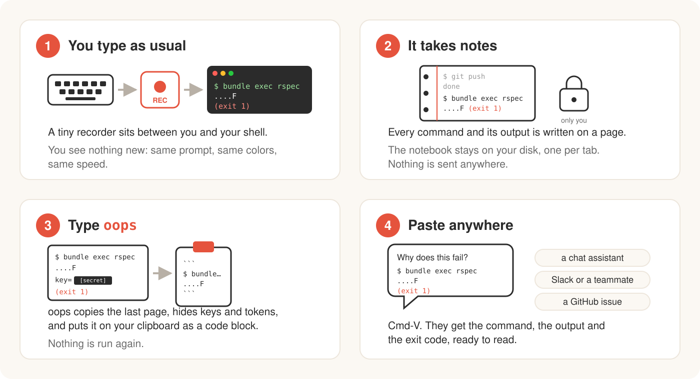

# oops

English | [日本語](README.ja.md)

[](https://rubygems.org/gems/oops-cli) [](https://github.com/ysb3996-blip/oops/actions/workflows/ci.yml) [](LICENSE)

Copy the last shell command and its output to the clipboard, ready to paste.

You ran a command and it failed. You want to show it to a chat assistant, a teammate on Slack, or a GitHub issue. Normally that means dragging to select the output, copying, pasting, and adding the code fences yourself. With oops it is two steps:

1. Type `oops` (or `oops err` for the last failed command).
2. Paste with Cmd-V.

What lands on your clipboard is a code block with the command, its output, and the exit code. Colors are stripped, and tokens, keys and email addresses are masked.

![Demo: a test fails, oops copies the command and its output, pbpaste shows the code block; then cat .env, oops, and the API key is shown as [secret]](docs/demo.gif)

## Install

```sh
gem install oops-cli
```

Homebrew tap: coming soon.

Requires Ruby 3.3 or newer on macOS or Linux (WSL counts as Linux), and zsh or bash. There are no runtime gem dependencies.

## Set up your shell

Add one line to your rc file (`~/.zshrc` for zsh, `~/.bashrc` for bash; if you keep your bash setup in `~/.bash_profile` on macOS, put it there):

```sh
eval "$(oops init zsh)"    # zsh
eval "$(oops init bash)"   # bash
```

Then open a new tab. Existing tabs pick it up after `exec zsh` (or `exec bash`).

Where to put the line matters:

- Put it **after** whatever puts the Ruby that has oops on your `PATH` (rbenv, asdf, mise, Homebrew `shellenv`, and so on). On macOS, login shells reset `PATH`, so if the line comes first, the system Ruby 2.6 may be picked and oops will not start. If oops cannot run, your shell still starts normally, just without recording.
- Put it **before** slow or noisy setup that you do not want to run twice (nvm, prompt themes, banners). The snippet starts your shell again under a small recorder (`oops record`, a pty relay), so anything above the line runs once in the outer shell and again in the inner one. Anything below it runs only in the inner shell.
- With powerlevel10k, put the line **above** the instant prompt block at the top of `~/.zshrc`. The instant prompt redirects the shell's input and output while the rest of `~/.zshrc` runs, and the snippet does nothing then (it only acts on a real terminal), so oops would silently not record. If a tab is not recorded although the line is in `~/.zshrc`, run `oops doctor`: it shows `recording: no`.
- In zsh the shell is restarted as a non-login shell, so setup that lives only in `~/.zlogin` is not applied to the recorded shell. Keep it in `~/.zprofile` or `~/.zshrc` (above the line). In bash, a login shell is restarted with `-l`.

If something looks wrong, run `oops doctor`. It reports whether this tab is recorded, the shell and whether the hooks are loaded, which clipboard method will be used, the config file, the size of the session logs, and the Ruby version.

To turn oops off for one shell, start it with `OOPS_DISABLE=1` (for example `OOPS_DISABLE=1 zsh`). The snippet then does nothing.

## Usage

| Command | What it does |
|---|---|
| `oops` | Copy the last command and its output |
| `oops 3` / `oops -n 3` | Copy the last 3 commands (oldest first) as one code block |
| `oops err` | Copy the last command that exited non-zero, skipping over successful ones |
| `oops err -n 2` | Copy the last 2 failed commands (oldest first), skipping over successful ones |
| `oops init zsh` / `oops init bash` | Print the shell snippet (for `eval`) |
| `oops doctor` | Diagnose recording, hooks, clipboard, config and log size |
| `oops pause` / `oops resume` | Stop and restart recording. While paused, nothing is written to disk |
| `oops status` | Print `recording`, `paused` or `off` on one line, for scripts and prompts |
| `oops record -- <shell>` | Internal: runs a shell under the recorder. The snippet calls this |
| `oops --version`, `oops --help` | Version and usage |

Options for `oops`, `oops N` and `oops err`:

| Option | What it does |
|---|---|
| `-n N` | Copy the last N commands (with `err`, the last N failed commands) |
| `--github` | Format for a GitHub issue or PR comment |
| `--tail N` | Keep only the last N output lines |
| `--head N` | Keep only the first N output lines (with `--tail`, keeps both ends) |
| `--time` | Add the time each command started as a `# 2026-10-31 19:30:09 +09:00` line |
| `--output-only` | Leave out the `$ command` line and copy only the output |
| `--show-secrets` | Do not mask secrets and do not apply the replace table |

`N` must be a positive integer. Specify the command count once, either as a positional `N` or with `-n N`; combining them or repeating `-n` is a usage error. If fewer matching commands are available, oops copies those it finds. `-n` can be combined with the formatting options above.

`oops` never copies itself: if the previous command was `oops`, you get the command before it.

Exit codes: `0` copied, `1` nothing copied (not recording, no command yet, no failed command, paused, or the clipboard command failed), `2` usage error.

### Default output

`oops` prints one line such as `copied: $ bundle exec rspec (5 lines, 2 secrets masked)` and puts this on the clipboard:

````
```
$ bundle exec rspec
....F

Failures:
  1) User#name returns full name
     expected "Taro Yamada", got "Taro"
(exit 1)
```
````

`(exit N)` appears only when the exit code is not 0. If the output itself contains a code fence, the block is fenced with four backticks instead.

### `--github`

Output of 30 lines or fewer becomes a `console` block, which GitHub highlights as a shell session:

````
```console
$ bundle exec rspec
....F
(exit 1)
```
````

Longer output is wrapped in a collapsible section whose summary shows the command, exit code and line count:

````
<details>
<summary><code>$ bundle exec rspec</code> — exit 1, 312 lines</summary>

```console
$ bundle exec rspec
...
(exit 1)
```

</details>
````

### `--tail` and `--head`

`oops --tail 50` keeps the last 50 lines of output and puts `... 2,950 lines omitted ...` before them. `--head 20` keeps the first 20 and puts the marker after. With both, the middle is replaced by one marker line. With `oops 3`, the limits apply to each command.

### `--time` and `--output-only`

`oops --time` puts the local time the command started on a `#` line before each `$ command`, and adds it to the `--github` summary. `oops --output-only` leaves out the `$ command` line and keeps the output and `(exit N)`; the `copied: $ ...` line on screen and the `--github` summary then show the exit code and line count without the command. Both can be combined with the other options:

````
```
# 2026-10-31 19:30:09 +09:00
....F
(exit 1)
```
````

### `oops status`

`oops status` prints `recording`, `paused` or `off` (this shell is not recorded, or its log was deleted) and exits `0` only when recording. It prints no error, so a prompt or script can call it, for example with a [starship custom module](https://starship.rs/config/#custom-commands). Each call starts Ruby, which takes roughly 0.1 to 0.2 seconds; `oops doctor` tells more when the answer is `off`.

## Configuration

Optional file at `${XDG_CONFIG_HOME:-~/.config}/oops/config.yml`:

```yaml
replace:            # plain string replacements applied when copying
  takeuchi: dev
  MacBook-Pro: laptop
secrets:            # extra regular expressions to mask
  - "sk_live_[A-Za-z0-9]+"
clipboard: auto     # auto | pbcopy | wl-copy | xclip | xsel | clip.exe | osc52 | any command (reads stdin)
```

- Replacements and masking are applied at the moment you copy; the recorded log stays untouched, so a config change also affects earlier commands.
- `replace` keys are applied longest first and are case-sensitive.
- Unknown keys produce a warning and are ignored. A broken YAML file produces a warning and oops carries on without a config.
- With `clipboard: auto`, oops tries `pbcopy` on macOS, `clip.exe` on WSL, `wl-copy` on Wayland, `xclip` or `xsel` on X11, and falls back to the OSC 52 terminal escape sequence (also used over SSH). `oops doctor` shows which one it picked.
- A custom `clipboard:` command runs in its own process group with a 5 second timeout, so it must not read from or configure the terminal (no password prompts, no `stty`); Ctrl-C during a copy does not reach it.

Built-in masking covers AWS access keys, GitHub, GitLab, Slack, npm, OpenAI/Anthropic (`sk-...`), Stripe and Google API tokens, Slack webhook URLs, JWTs, `Authorization` header values, private key blocks (also when the END line is missing), values assigned to names containing `key`, `token`, `secret`, `password`, `passwd` or `pwd`, passwords given as `--password <value>`, `curl -u user:pass`, `mysql -p<value>` or `docker login -p <value>`, email addresses, credentials inside URLs, and public IPv4 addresses (loopback and private ranges are left alone). It is applied to the command line as well as the output.

Masking is pattern based, so it is a safety net, not a guarantee: a secret in a format it does not know (a bare password printed on its own line, for example) is copied as it is. Read what you are about to paste, and add your own patterns under `secrets:` in the config file.

## How it works



1. `oops init` prints a snippet that you `eval` from your rc file. In an interactive shell on a terminal that is not recorded yet, it restarts the shell under `oops record`.
2. `oops record` is a small Ruby pty relay: it passes your keystrokes and the shell's output through untouched and forwards window resizes to the shell.
3. Hooks in the shell (zsh `preexec`/`precmd`, bash `DEBUG` trap and `PROMPT_COMMAND`) emit invisible APC markers around each command. The relay strips them, so your terminal never sees them.
4. For each finished command the relay appends one JSON line (command, directory, times, exit code, raw output) to a per-tab log under `${XDG_STATE_HOME:-~/.local/state}/oops/sessions/`. Output is capped at 1 MB per command (the tail is kept). Each tab's log is capped at 50 MB: when it passes that, it is rewritten to keep only its newest commands (down to about 37 MiB). When a tab starts recording, logs of closed tabs are deleted, oldest first, until all logs together take at most 50 MB; logs of open tabs are never deleted, so several busy tabs can together use more.
5. `oops` reads the end of the current tab's log, cleans and masks the text, builds the code block and hands it to the clipboard. Nothing is ever re-run.

## Privacy and security

- The session logs hold the raw, **unmasked** output of every recorded command. Masking and the replace table are applied only when you copy. The logs live under `${XDG_STATE_HOME:-~/.local/state}/oops/sessions/`, readable only by you (mode 0600, directory 0700). To delete all of them, run `rm -rf "${XDG_STATE_HOME:-$HOME/.local/state}/oops"` (by default `rm -rf ~/.local/state/oops`). Use `oops pause` before showing secrets you do not want on disk.
- To report a security problem privately, see [SECURITY.md](SECURITY.md). Please do not open a public issue for it.
- Recorded output is untrusted: any program you run can print text that looks like oops's markers. oops therefore obeys a pause or resume marker only when it agrees with the flag file that `oops pause` and `oops resume` set, so output cannot silently pause recording. A program can still fake where a command starts and ends in the log, so check what you paste.

## Known limitations

- Each recorded tab keeps one Ruby process alive (about 17 MB).
- `sudo -s` or `su` that drops the environment starts a second, nested recording, so those commands are logged twice.
- Only the current tab is available. A tab you closed, or an earlier tab, cannot be retrieved.
- Via OSC 52 (SSH, or no clipboard tool), terminals limit how much can be sent at once. oops truncates to roughly 100 KB and warns. OSC 52 is a one-way escape sequence, so oops cannot tell whether the terminal accepted the copy; some terminals ignore it or ask first, and tmux needs `set -g set-clipboard on`.
- Commands longer than 8192 characters are truncated in the recorded command line.
- Output of full-screen apps (vim, less, tmux and so on) is not kept; it is replaced by `[full-screen app output omitted]`.
- A command line that starts with a space is recorded in zsh but dropped in bash (bash does not save it to history, which is where oops reads the command).
- bash with [bash-preexec](https://github.com/rcaloras/bash-preexec) (also behind atuin and Ghostty's bash integration): oops registers its hooks with it instead of using its own `DEBUG` trap, whichever of the two comes first in your rc file. A line that bash did not save to history (`HISTCONTROL=ignorespace`, `HISTIGNORE`) is then recorded as `(not saved in history)`, because the text of the line is read from history there. Without bash-preexec, oops records the first command of such a line instead.
- bash in Ghostty: Ghostty adds its shell integration (prompt marks, new tabs in the same directory, titles) only to the outer shell, so the recorded shell does not get it. To add it back, put this below the oops line in `~/.bashrc` (checked with bash 3.2): `[ -n "$GHOSTTY_RESOURCES_DIR" ] && source "$GHOSTTY_RESOURCES_DIR/shell-integration/bash/ghostty.bash"`. zsh needs nothing: the snippet does it.
- bash: the line after a pipeline sees `PIPESTATUS` with only the last status (`false | true`, then `echo ${PIPESTATUS[*]}` prints `0`, not `1 0`), because oops's `PROMPT_COMMAND` entry runs first. `$?` and `$_` are kept. A prompt that shows pipeline statuses (starship's `pipestatus`) shows less in bash. zsh keeps `pipestatus`.
- macOS: `pbcopy` chooses its text encoding from `LANG` / `LC_*`. If Japanese or other non-ASCII text arrives garbled, check that a UTF-8 locale is set (for example `LANG=en_US.UTF-8`), which can be missing in shells started over SSH.
- fish and native Windows are not supported yet.

## Development

### Set up your machine

You need Git, Ruby 3.3 or newer, [Bundler](https://bundler.io/) (it ships with Ruby), and both zsh and bash (the end-to-end tests start real shells). macOS has zsh and bash; on Debian or Ubuntu run `sudo apt-get install zsh`.

```sh
git clone https://github.com/ysb3996-blip/oops.git
cd oops
```

The repository pins Ruby 4.0.9 in `.ruby-version`. With a version manager such as rbenv, asdf or mise, install that version (`rbenv install 4.0.9`, then `rbenv rehash`). Any Ruby 3.3 or newer also works if you delete or ignore the pin. Check with `ruby -v`.

```sh
bin/setup                   # checks Ruby, zsh and bash, installs gems, runs the checks
```

`bin/setup` is the same as `bundle install` followed by `bundle exec rake`. `bundle exec rake` runs the whole test suite (about 30 seconds) and then rubocop (style check); `bundle exec rake test` and `bundle exec rubocop` run them one at a time.

CI runs both on Ubuntu and macOS with Ruby 3.3, 3.4 and 4.0, builds the gem, and runs shellcheck on the bash snippet (`shellcheck -S warning lib/oops/shell/oops.bash bin/setup`, if you have it). Before opening a pull request, run:

```sh
bundle exec rake && gem build oops-cli.gemspec
```

### Try your changes

Run a single test file with `bundle exec ruby -Itest -Ilib test/ansi_test.rb`. To run the command straight from the checkout, without installing anything:

```sh
bundle exec exe/oops --version
bundle exec exe/oops doctor
```

To try it as your shell does, build and install the gem into the Ruby you are using, then add the line from "Set up your shell" to a **new** tab:

```sh
gem build oops-cli.gemspec
gem install ./oops-cli-0.1.0.gem     # the file name follows lib/oops/version.rb
rbenv rehash                         # only with rbenv
```

- A gem is installed per Ruby version. If a new tab uses another Ruby than the one you installed into (for example the repository pins 4.0.9, but your global Ruby is 3.3.5), the shell prints `oops: command not found`. Run `gem install` again under that Ruby, e.g. `RBENV_VERSION=3.3.5 gem install ./oops-cli-0.1.0.gem`.
- Reinstall after every change. The installed gem is a copy, not a link to your checkout.
- To remove it: `gem uninstall oops-cli`.
- Put `eval "$(oops init zsh)"` in your rc file, not just at the prompt: the recorded shell reads the rc file again, and without the line it has no hooks (`oops doctor` shows `hooks: missing`).

Never run `oops record` in the terminal you are working in; the tests drive it through their own pty. Try it in a new terminal tab instead. To delete the logs your experiments leave behind, see "Privacy and security".

The tests cover formatting, secret masking, the log reader, the stream parser and an end-to-end run of the relay with real zsh and bash.

Manual checklist before a release:

- No marker garbage is visible in Ghostty, Terminal.app and the VS Code integrated terminal.
- vim, less and a full-screen terminal app keep up while you resize the window.
- `exec zsh` in a recorded tab does not start a second recording.
- A VS Code terminal opened with `code .` from a recorded tab is recorded on its own.

## Contributing

Bug reports, ideas and pull requests are welcome. See [CONTRIBUTING.md](CONTRIBUTING.md); issues labeled `good first issue` are a good place to start.

## License

MIT. See [LICENSE](LICENSE).
